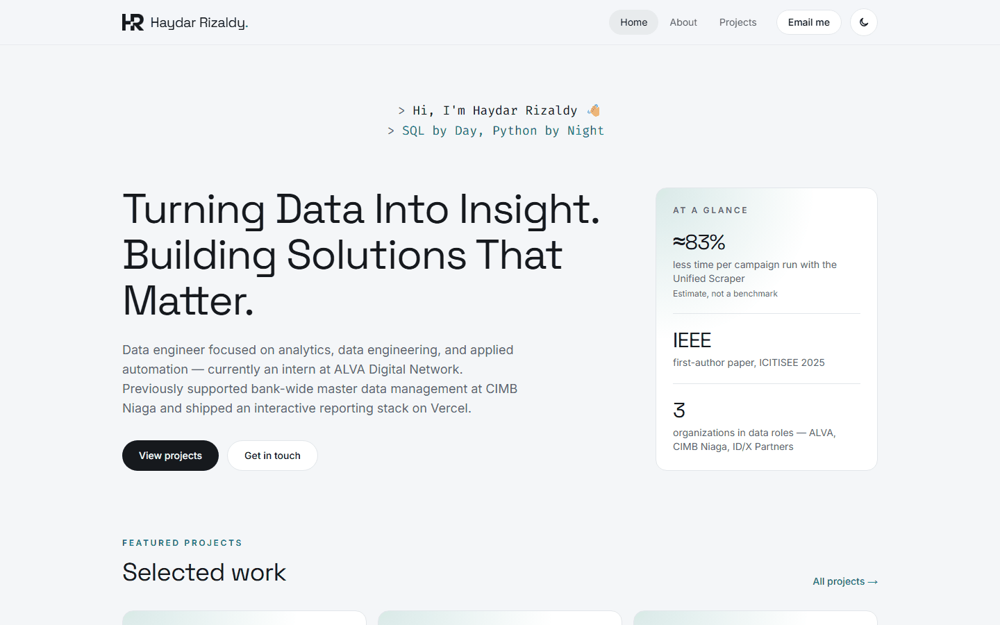

<div align="center">


# Haydar Rizaldy — Portfolio

**Data & Technology Professional** — analytics, data engineering, and applied automation.

[**Live site**](https://haydarrizaldy.vercel.app) ·
[LinkedIn](https://www.linkedin.com/in/haydar-rizaldy/) ·
[GitHub](https://github.com/HaydarRizaldy) ·
[Email](mailto:haydarrizaldyputera@gmail.com)

</div>

[](https://haydarrizaldy.vercel.app)

## About

Source code for my personal portfolio at **[haydarrizaldy.vercel.app](https://haydarrizaldy.vercel.app)**.
I'm a data engineer focused on analytics, data engineering, and applied automation — currently an intern at
ALVA Digital Network. Previously I supported bank-wide master data management at CIMB Niaga and shipped an
interactive reporting stack on Vercel.

## Pages

| Page | What's there |
|---|---|
| [Home](https://haydarrizaldy.vercel.app) | Introduction, at-a-glance highlights, featured projects, experience, contact |
| [About](https://haydarrizaldy.vercel.app/about) | Experience timeline, education, skills & certifications |
| [Projects](https://haydarrizaldy.vercel.app/projects) | Curated work with a case study for each project |

## Featured projects

| Project | Summary | Links |
|---|---|---|
| **Unified Social Media Scraper** | Queue-driven internal app for Instagram & TikTok comment extraction and thumbnail downloads — an estimated 83% less time per campaign run (estimate, not a benchmark). | [Case study](https://haydarrizaldy.vercel.app/projects/unified-scraper) · repository is private |
| **Personalized Online Course Recommender** | Research on course recommendation with truncated SVD and clustering — first-author paper at IEEE ICITISEE 2025. | [Case study](https://haydarrizaldy.vercel.app/projects/course-recommender) · [DOI](https://doi.org/10.1109/ICITISEE68184.2025.11355135) |
| **Credit Risk Prediction** | End-to-end credit-risk model, from preprocessing to evaluation — final project of the ID/X Partners data-science virtual internship. | [Case study](https://haydarrizaldy.vercel.app/projects/credit-risk-prediction) · [Repository](https://github.com/HaydarRizaldy/Credit-Risk-Prediction-and-Analysis) |

## Built with

- [Next.js 16](https://nextjs.org) (App Router) · React 19 · TypeScript
- [Tailwind CSS v4](https://tailwindcss.com) with light/dark design tokens
- `next/font` — Inter, Space Grotesk, Fira Code
- Deployed on [Vercel](https://vercel.com)

## Features

- Light and dark themes that follow the system setting, with a manual toggle
- Typewriter greeting that respects reduced-motion preferences
- Reusable case-study template (challenge → solution → capabilities → impact → contribution)
- SEO metadata, generated Open Graph image, sitemap, and robots.txt
- Accessible navigation: skip link, visible focus states, semantic landmarks

## Run locally

```bash
npm install
npm run dev     # http://localhost:3000
npm run lint
npm run build
```

Site copy lives in [`src/content/`](src/content) (profile, experience, education, skills, projects), so most text
changes don't touch components. Production deploys run with `vercel deploy --prod`.

---

<div align="center">

© Haydar Rizaldy · <a href="https://haydarrizaldy.vercel.app">haydarrizaldy.vercel.app</a>

</div>
